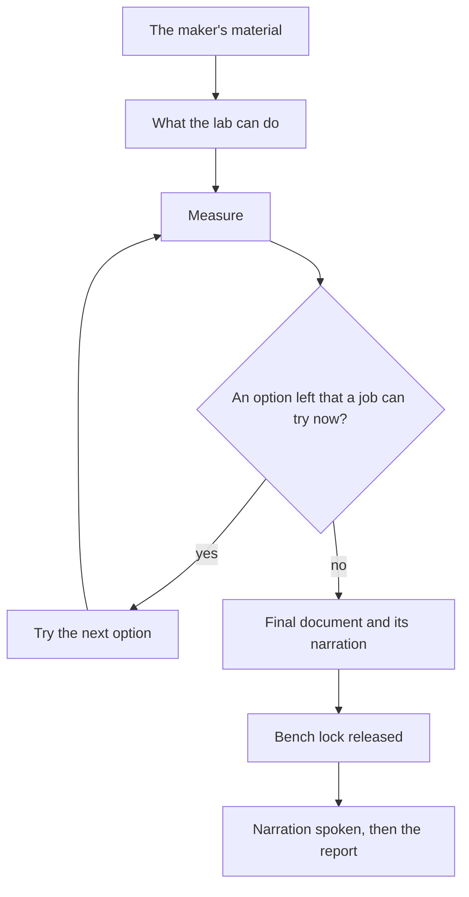

# Researching and benching

## The order of the work

- **1. The maker's material first.** How the thing is built and how it is tuned are read from its
  maker before anyone writing about it: the official documentation, the repository's README, docs
  and code, the release notes and changelog, the model card, the configuration files, the paper in
  full, and the issues and pull requests for what the documentation leaves out. What others write
  comes after and is told apart as theirs. The deep dive's rules bind how it is read and told,
  `~/.local/share/bmo-agency/deploy/prompts/rules/deep-dives.md`.
- **2. What our lab can do with it.** The lab's machines and cards are read from the brain's chunk on
  the compute nodes, `knowledge/compute-nodes-gpu.md`, never from memory. GPU work goes on the GPU node
  pool through each node's card arbiter: a card is taken by its hold, never by stopping
  another's service by hand.
- **3. Measure.** Every figure stands beside the maker's own for the same measure, with the
  conditions of each; a run is repeated and its spread written; raw logs stay where the repository
  keeps its measurements. A value that cannot be measured now is a calculation shown whole.
- **4. Every option, until none is left.** The job raises its own options out of what 1 to 3 found,
  each a lever with the effect it is expected to have, and tries them one at a time: measured,
  adopted or rejected with its reason. A candidate a result turns up joins the list. The work stops
  only when no option a job can try now is left, never after the first measurement.
- **An option no job can try now** — hardware not yet in the lab, infrastructure only the owner changes, a
  purchase — is not tried. It goes into the document under 나중에 할 수 있는 선택지 with the effect
  expected and what it needs, and the work carries on with the rest.
- **The document is built as the work goes.** Its working copy is kept in the item's own folder
  under the workbench, which outlives the job, each option's order, measurement, verdict and reason
  added as it ends. A repository that keeps measurements in its own documents has them
  written there too.

## A capability nobody has confirmed

- **Check first:** the maker's own material, the code, the issues and pull requests, and a real run.
- **Where it exists, use it and measure it.**
- **Where it does not, port it or patch it.** Find whether it can be ported into an engine of our own
  or written as a patch of our own, then do it, check it the way that engine's repository checks a
  patch, and measure it. The repository holding each engine says how a patch is made, checked and
  installed.
- **Each step goes into the document:** what was looked at, what it answered, what was built and
  what it measured. "Not confirmed" is never a finding.

## Nothing handed back

- **No option is put to the owner.** Never `bmo job ask` between options the job can try, and never a report
  that lists them for him to pick from: trying them is the work.
- **No interim report.** The job reports once, at the end, with the final document; nothing is told
  to a room about how far it has got.

## The final document

- **A deep dive in the deployment's 아카이브,** filed with `archive-doc` and `--narration` as the
  `bmo-asking-the-owner` skill says: what the maker states first, then the method, the raw material,
  the tables and figures, the reasoning behind the verdict, the configuration adopted, and the
  options for later.
- **What is still open is only what no job can reach now,** each with what puts it there. A value a
  job could have measured is measured, never marked `추정` or `확인 필요`.
- **The narration** is written by the rules of a deep dive's, `deep-dives.md` 「The narration」.
- **It is reported only once its voice is ready.** `archive-doc` launches the narration and returns
  before it is spoken. Wait, marked as the `bmo-marking-a-wait` skill says, until the document keeps its
  sound: an attachment of media `audio` on the document, read with
  `~/.local/share/bmo/deploy/bin/bmo query`. Where the narration's run failed, launch it again
  with `bmo voice brief --chat <the room> --by <your item> --document <id>`, the narration on its
  standard input from its file. Only then does the document's address go into the report.

## The bench lock

- **A bench lock is whatever the job took so a measurement owns the lab:** a service stopped and its
  requests refused, an engine emptied, a card held through its arbiter.
- **The job releases it before it reports:** the best configuration brought back up and its health
  read through its own checks, requests let through again, every card hold let go. The report says
  what was released and at what time.
- **Work set aside for the bench is the chat agent's to resume.** A job never takes a hold off: the report names
  each item set aside for the bench as ready to start now, and a hold carrying the bench's item as
  its condition is told to the chat agent by the bot when the item closes.
